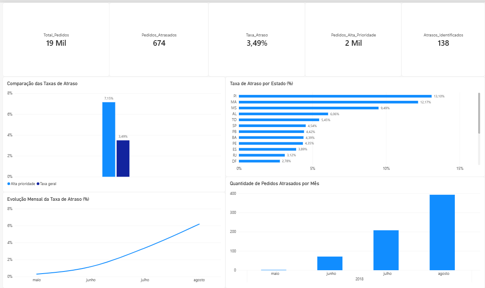
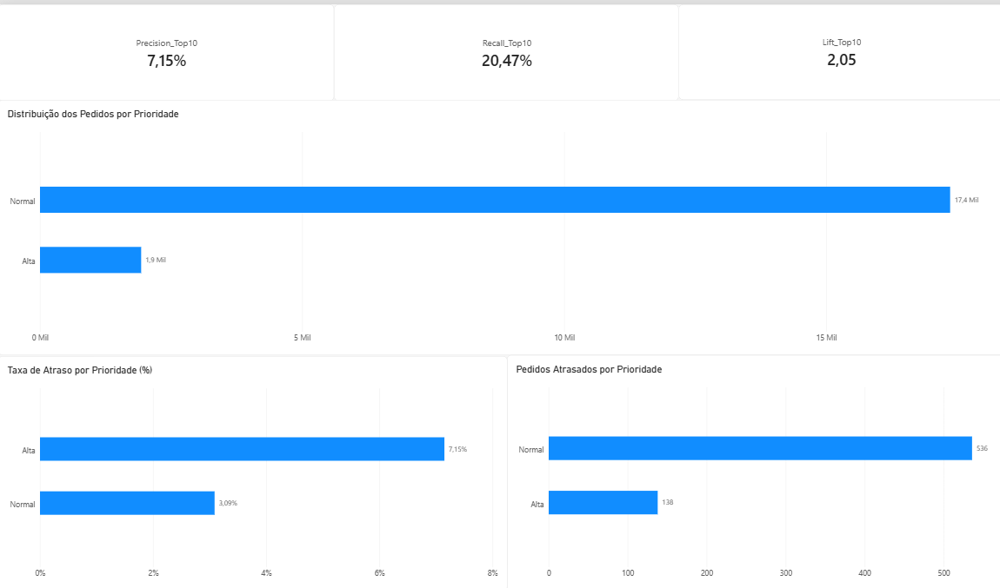

# FoodOps AI — Previsão de Atrasos em Entregas

**Machine Learning | Python | SQL | Power BI | Ciência de Dados | Logística**

## Sobre o projeto

O **FoodOps AI** é um projeto de Ciência de Dados desenvolvido para identificar pedidos de e-commerce com maior risco de atraso na entrega, utilizando dados públicos da Olist.

O projeto integra **Python, Machine Learning, SQL e Power BI** para analisar o desempenho logístico, identificar padrões de atraso e avaliar como modelos preditivos podem apoiar a priorização de pedidos.

O objetivo é transformar dados históricos em informações úteis para a tomada de decisões operacionais, direcionando a atenção aos pedidos com maior risco previsto.

## Problema de negócio

Em operações de e-commerce, acompanhar todos os pedidos com a mesma intensidade pode ser inviável devido ao grande volume de entregas.

Uma possível solução é utilizar Machine Learning para classificar os pedidos de acordo com seu risco de atraso e concentrar o monitoramento nos casos prioritários.

**Pergunta central do projeto:**

> Ao priorizar os 10% dos pedidos com maior risco previsto, quantos atrasos reais conseguimos identificar?

Para responder a essa questão, foram desenvolvidas análises exploratórias, modelos preditivos, consultas SQL e um dashboard de indicadores logísticos.

## Tecnologias utilizadas

| Tecnologia | Aplicação |
|---|---|
| Python | Processamento, análise e modelagem dos dados |
| Pandas e NumPy | Limpeza, integração e transformação dos dados |
| Scikit-learn | Treinamento e avaliação dos modelos |
| XGBoost | Comparação de algoritmos de Machine Learning |
| Matplotlib | Visualização exploratória dos dados |
| SQLite | Armazenamento e consultas SQL |
| Google Colab | Desenvolvimento e execução dos notebooks |
| Power BI | Visualização de indicadores e resultados do modelo |
| GitHub | Versionamento e documentação |

## Metodologia

O projeto foi desenvolvido em três frentes principais.

### 1. Análise de dados e Machine Learning

1. Carregamento, limpeza e integração das bases da Olist.
2. Construção da variável-alvo de atraso na entrega.
3. Análise exploratória dos pedidos e das características logísticas.
4. Engenharia de atributos relacionados a frete, vendedores, rotas e prazos.
5. Separação temporal dos dados em treinamento, validação e teste.
6. Treinamento e comparação de Regressão Logística, Random Forest e XGBoost.
7. Seleção do modelo com base no desempenho na validação.
8. Avaliação final no conjunto de teste reservado.

O modelo selecionado foi a **Regressão Logística sem pesos de classe**.

### 2. Análise SQL

Foi desenvolvido um notebook específico para consultas SQL, utilizando SQLite integrado ao Python.

O objetivo dessa etapa foi explorar os indicadores logísticos e validar os resultados apresentados no modelo e no Power BI.

Foram utilizadas operações como:

- `SELECT`, `COUNT()` e `SUM()` para calcular indicadores.
- `GROUP BY` para realizar análises por estado, mês e prioridade.
- `ORDER BY` para ordenar os resultados.
- `ROUND()` para calcular taxas percentuais.
- `CASE WHEN` para construir cálculos condicionais.
- `SUBSTR()` para agrupar os pedidos por mês.

### 3. Dashboard no Power BI

Foi desenvolvido um dashboard com duas páginas:

**Análise Operacional:** apresenta os indicadores gerais dos pedidos, a distribuição dos atrasos por estado, a evolução mensal e a comparação das taxas de atraso.

**Desempenho do Modelo:** apresenta as métricas de priorização e compara os pedidos classificados como prioridade alta e normal.

## Resultados do Machine Learning

O conjunto de teste final contém **19.294 pedidos entregues**, referentes ao período de maio a agosto de 2018.

Desses pedidos, **674 apresentaram atraso**, correspondendo a uma taxa geral de 3,49%.

### Métricas do modelo

| Métrica | Resultado |
|---|---:|
| Pedidos avaliados | 19.294 |
| Pedidos atrasados | 674 |
| Taxa geral de atraso | 3,49% |
| ROC-AUC | 0,7064 |
| Average Precision | 0,0704 |
| Brier Score | 0,0346 |
| Precision@10% | 7,15% |
| Recall@10% | 20,47% |
| Lift@10% | 2,05x |

Ao selecionar os 10% dos pedidos com maior risco previsto, o modelo identificou **138 atrasos reais entre 1.930 pedidos prioritários**.

A taxa de atraso nesse grupo foi aproximadamente 2,05 vezes maior que a taxa geral do conjunto de teste.

O resultado demonstra capacidade de concentração dos atrasos, embora a maior parte dos eventos ainda permaneça fora do grupo prioritário.

## Análise SQL — Perguntas de negócio

As consultas SQL foram utilizadas para investigar o comportamento dos atrasos e validar os principais indicadores do projeto.

### Pergunta 1 — Quantos pedidos atrasaram e qual foi a taxa geral de atraso?

| Indicador | Resultado |
|---|---:|
| Total de pedidos | 19.294 |
| Pedidos atrasados | 674 |
| Taxa de atraso | 3,49% |

**Análise:** Aproximadamente 3,49% dos pedidos avaliados foram entregues após o prazo estimado. Esse indicador estabelece uma referência para comparar o desempenho logístico entre estados, meses e grupos de prioridade.

### Pergunta 2 — Quais estados apresentaram as maiores taxas de atraso?

| Estado | Total de pedidos | Atrasados | Taxa de atraso |
|---|---:|---:|---:|
| PI | 84 | 11 | 13,10% |
| MA | 115 | 14 | 12,17% |
| MS | 137 | 13 | 9,49% |
| AL | 66 | 4 | 6,06% |
| TO | 55 | 3 | 5,45% |
| SP | 8.921 | 405 | 4,54% |

**Análise:** Piauí, Maranhão e Mato Grosso do Sul apresentaram as maiores taxas de atraso entre os estados analisados.

São Paulo, por sua vez, apresentou um volume expressivo de atrasos, com 405 ocorrências entre 8.921 pedidos.

Os resultados demonstram a importância de considerar tanto a taxa percentual quanto o volume absoluto de atrasos. Estados com poucas observações podem apresentar taxas elevadas mesmo com um número reduzido de ocorrências.

### Pergunta 3 — O modelo conseguiu concentrar mais atrasos nos pedidos de alta prioridade?

| Indicador | Alta prioridade | Prioridade normal |
|---|---:|---:|
| Total de pedidos | 1.930 | 17.364 |
| Pedidos atrasados | 138 | 536 |
| Taxa de atraso | 7,15% | 3,09% |

**Análise:** O grupo de alta prioridade apresentou uma taxa de atraso aproximadamente 2,31 vezes maior que o grupo de prioridade normal.

Esse resultado indica que o modelo conseguiu distinguir um conjunto de pedidos com maior incidência de atrasos, oferecendo potencial para apoiar a organização de filas de monitoramento logístico.

### Pergunta 4 — Como os atrasos evoluíram ao longo dos meses?

| Mês | Total de pedidos | Atrasados | Taxa de atraso |
|---|---:|---:|---:|
| Maio/2018 | 691 | 2 | 0,29% |
| Junho/2018 | 6.096 | 71 | 1,16% |
| Julho/2018 | 6.156 | 208 | 3,38% |
| Agosto/2018 | 6.351 | 393 | 6,19% |

**Análise:** A taxa de atraso aumentou ao longo dos meses observados, passando de 0,29% em maio para 6,19% em agosto.

Agosto apresentou a maior quantidade de atrasos, com 393 ocorrências.

Essa evolução indica uma mudança relevante no comportamento dos pedidos presentes no conjunto de teste, mas não permite identificar suas causas nem generalizar a tendência para toda a operação logística.

### Pergunta 5 — Qual foi a capacidade de identificação e concentração dos atrasos?

As consultas SQL também permitiram validar duas métricas importantes do modelo.

| Métrica | Resultado |
|---|---:|
| Recall@10% | 20,47% |
| Lift@10% | 2,05x |

**Análise:** Ao selecionar os 10% dos pedidos com maior risco previsto, o modelo conseguiu identificar 20,47% dos atrasos reais.

O Lift@10% de 2,05x demonstra que a taxa de atraso no grupo selecionado foi aproximadamente duas vezes maior que a taxa geral.

Esses resultados reforçam o potencial do modelo para apoiar a priorização de pedidos, considerando as limitações da avaliação histórica.

## Dashboard — Power BI

O dashboard foi desenvolvido para apresentar os resultados de forma visual e facilitar a interpretação dos indicadores.

### Página 1 — Análise Operacional



Esta página apresenta:

- Total de pedidos analisados.
- Quantidade e taxa geral de atrasos.
- Quantidade de pedidos classificados como alta prioridade.
- Atrasos identificados no grupo prioritário.
- Taxa de atraso por estado.
- Evolução mensal da taxa de atraso.
- Quantidade mensal de pedidos atrasados.

### Página 2 — Desempenho do Modelo



Esta página apresenta:

- Precision@10%.
- Recall@10%.
- Lift@10%.
- Distribuição dos pedidos por prioridade.
- Taxa de atraso por prioridade.
- Quantidade de atrasos em cada grupo.

O dashboard complementa as análises em Python e SQL, permitindo visualizar os resultados sob uma perspectiva operacional.

**Arquivo:** `FoodOps_AI_Dashboard.pbix`

## Integração entre Python, SQL e Power BI

O FoodOps AI foi estruturado para conectar diferentes etapas de um projeto de Ciência de Dados.

**Python e Machine Learning:** utilizados na preparação dos dados, construção dos atributos, treinamento dos modelos e geração das pontuações de risco.

**SQL:** utilizado para consultar os dados, calcular indicadores e validar os resultados das análises.

**Power BI:** utilizado para transformar os indicadores em visualizações que facilitam a interpretação e a comunicação dos resultados.

Essa integração demonstra como diferentes ferramentas podem ser utilizadas de maneira complementar para investigar um problema de negócio.

## Limitações

Apesar dos resultados obtidos, algumas limitações precisam ser consideradas:

1. **Mudança na distribuição dos dados:** a taxa de atraso diminuiu de 9,93% na validação para 3,49% no teste final, afetando a comparação das métricas.

2. **Desempenho em eventos pouco frequentes:** a Average Precision no teste final foi de 0,0704, refletindo a dificuldade de identificar atrasos em um conjunto com baixa prevalência do evento.

3. **Calibração das probabilidades:** a calibração não foi resolvida satisfatoriamente. Portanto, o risco previsto deve ser interpretado principalmente como um ranking relativo, e não como uma probabilidade absoluta confiável.

4. **Cobertura limitada dos atrasos:** aproximadamente 79,53% dos atrasos ficaram fora do grupo de alta prioridade.

5. **Dados históricos:** o estudo considera pedidos já entregues, o que limita a generalização dos resultados para pedidos ainda em andamento.

6. **Disponibilidade dos atributos:** não foi possível comprovar integralmente que todas as informações utilizadas estariam disponíveis no momento em que a previsão operacional precisaria ser realizada.

7. **Ausência de validação em produção:** o projeto foi avaliado com dados históricos, sem medir o impacto real da priorização sobre os processos logísticos.

## Estrutura do repositório

```text
FoodOps-AI/
│
├── FoodOps_AI_.ipynb
├── FoodOps_SQL_Comentado.ipynb
├── FoodOps_AI_Dashboard.pbix
├── foodops_ai_dashboard.csv
├── foodops_modelo.pkl
├── requirements.txt
├── analise_operacional.png
├── desempenho_modelo.png
├── README.md
└── .gitignore
```

### Descrição dos principais arquivos

| Arquivo | Descrição |
|---|---|
| `FoodOps_AI_.ipynb` | Análise de dados, treinamento e avaliação dos modelos |
| `FoodOps_SQL_Comentado.ipynb` | Consultas SQL, perguntas de negócio e interpretação dos resultados |
| `FoodOps_AI_Dashboard.pbix` | Dashboard desenvolvido no Power BI |
| `foodops_ai_dashboard.csv` | Dataset utilizado nas análises SQL e no dashboard |
| `foodops_modelo.pkl` | Modelo de Machine Learning salvo |
| `requirements.txt` | Dependências Python do projeto |

## Como explorar o projeto

**Machine Learning:** abra o notebook `FoodOps_AI_.ipynb` no Google Colab para examinar o processamento dos dados, os modelos e os resultados.

**SQL:** abra `FoodOps_SQL_Comentado.ipynb` no Google Colab. Carregue o arquivo `foodops_ai_dashboard.csv` e execute as células na ordem apresentada para criar o banco SQLite e reproduzir as consultas.

**Power BI:** abra o arquivo `FoodOps_AI_Dashboard.pbix` no Power BI Desktop para explorar as visualizações e os indicadores.

Os notebooks documentam as etapas desenvolvidas, mas a reprodução integral do treinamento depende da disponibilidade das bases originais e da configuração do ambiente.

## Próximas etapas

O projeto poderá ser expandido com novas funcionalidades:

- Desenvolver uma API com FastAPI para disponibilizar pontuações de risco.
- Investigar melhorias na calibração e no desempenho dos modelos.
- Validar a disponibilidade dos atributos no momento da previsão.
- Implementar testes automatizados e monitoramento de desempenho.
- Aprimorar a reprodutibilidade e a organização do pipeline.
- Explorar aplicações de inteligência artificial para apoiar a análise logística.

## Conclusão

O **FoodOps AI** demonstrou como Python, Machine Learning, SQL e Power BI podem ser integrados para analisar um problema de negócio relacionado à logística.

O modelo selecionado conseguiu concentrar uma proporção maior de atrasos entre os pedidos classificados como alta prioridade, identificando 20,47% dos atrasos reais ao selecionar aproximadamente 10% dos pedidos.

As consultas SQL permitiram explorar o comportamento dos atrasos e validar os principais indicadores apresentados no dashboard.

O projeto reforça a importância de conectar **análise de dados, modelagem preditiva, métricas de negócio e comunicação dos resultados**, reconhecendo as limitações necessárias para uma aplicação operacional confiável.

## Autoria

**Michele Rufino Tavares**

Graduada em Física Computacional pela Universidade Federal Fluminense (UFF) e estudante de Ciência de Dados.

Projeto desenvolvido como parte do portfólio de Ciência de Dados, com foco em análise de dados, Machine Learning e inteligência aplicada a operações logísticas.


